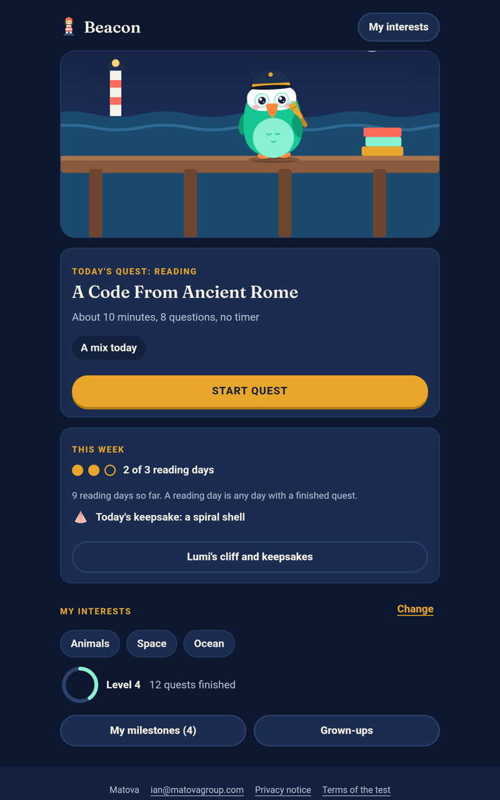
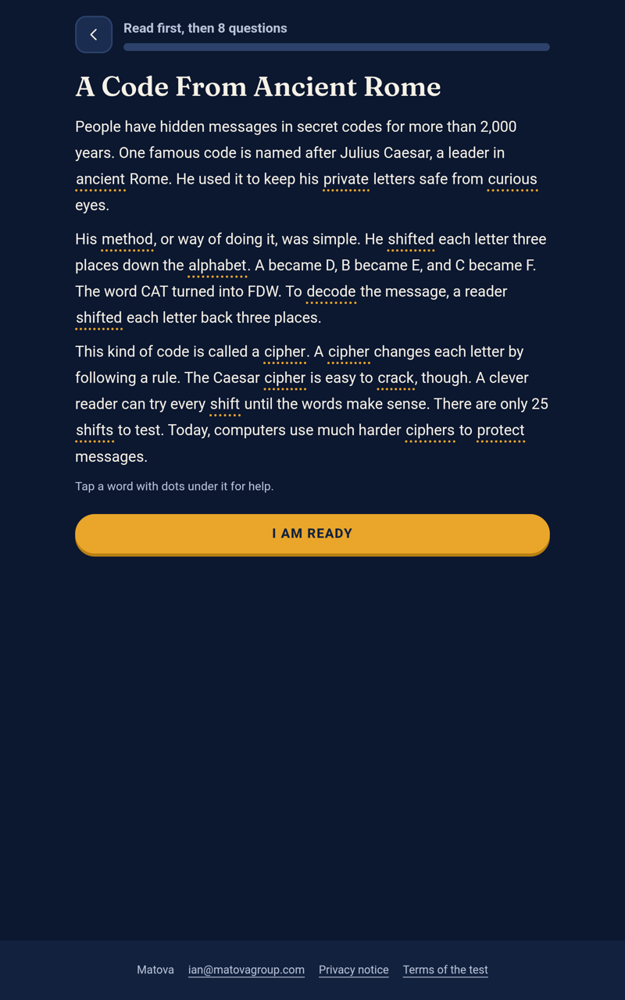
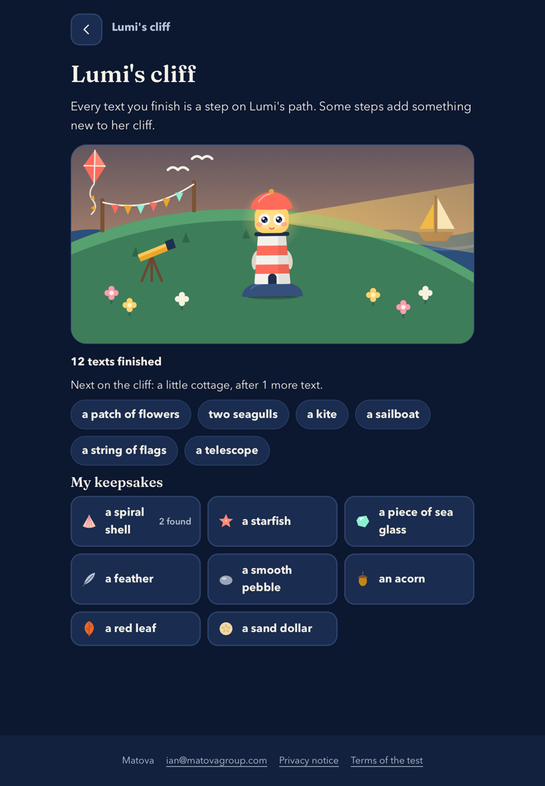

# Beacon tablet test

Beacon is an early test of a reading practice app for children, made by Matova. This page is for the families we invited to try it.

Beacon sends nothing to us or to anyone else. Your child's results stay on your tablet.

## New in version 0.5.0

- A weekly reading goal of 3 days, a small keepsake for the first text each day, and Lumi's cliff, which gains something new as your child reads. Missing a day takes nothing away.
- On Android tablets, a grown-up can turn on one daily reminder (Grown-ups, then Settings and privacy). It is off unless you turn it on, and the tablet asks you to allow notifications the first time.

## Install on an Android or Amazon Fire tablet

1. On the tablet, tap this link to download the app: [Beacon-test-0.5.0.apk](https://github.com/Irlewis91/beacon-tablet-test/releases/download/v0.5.0-preview/Beacon-test-0.5.0.apk) (46 MB).
2. Open the downloaded file. The tablet asks whether to allow installs from the app you used to open it (for example Chrome or Files). Allow it, go back, and tap Install. On a Fire tablet the setting is under Settings > Security & Privacy > Apps from Unknown Sources.
3. If a warning says the app comes from an unknown developer, tap More details, then Install anyway. It is our test app, and it is not in the Play Store yet.
4. Open Beacon from the home screen. You can turn the install setting back off afterwards.

Already have version 0.4.0? Install 0.5.0 the same way. It replaces the old version and keeps your child's progress.

## Use it on an iPad

1. On the iPad, open this link in Safari: https://irlewis91.github.io/beacon-tablet-test/
2. Tap the Share button (the square with an arrow, at the top). If you do not see Add to Home Screen, tap View More. Tap Add to Home Screen, then Add.
3. From now on, open Beacon from its icon on the Home Screen, not from Safari. Your child's progress is saved with that icon. In a Safari tab, Safari may clear saved progress after about a week without a visit.

On an iPad, Beacon needs the internet to open. It still sends nothing to us. It picks up new versions by itself and keeps your child's progress. The daily reminder is only in the Android app.

## When you are done

Open Beacon, tap Grown-ups, then Settings and privacy, then Clear data. On an Android tablet, deleting the app does the same. We hold no copy.

Questions: ian@matovagroup.com

Checksum (SHA-256) of version 0.5.0, for anyone who wants to check the file: `d46e1499ddc6e5ef4ec6e7996d9417cee3ba73ee62524e56d8f423665f1876ca`
